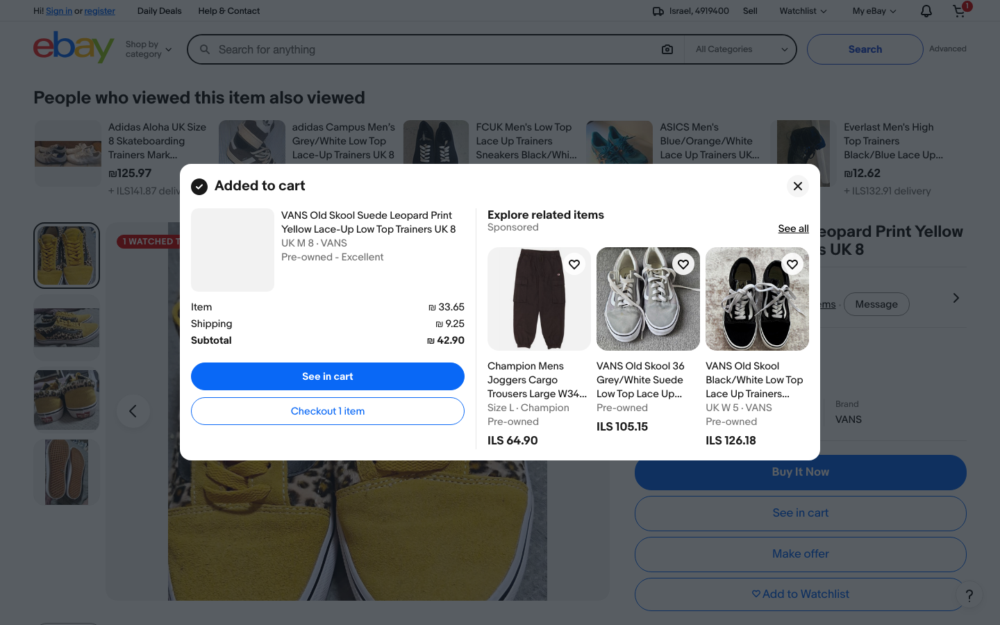
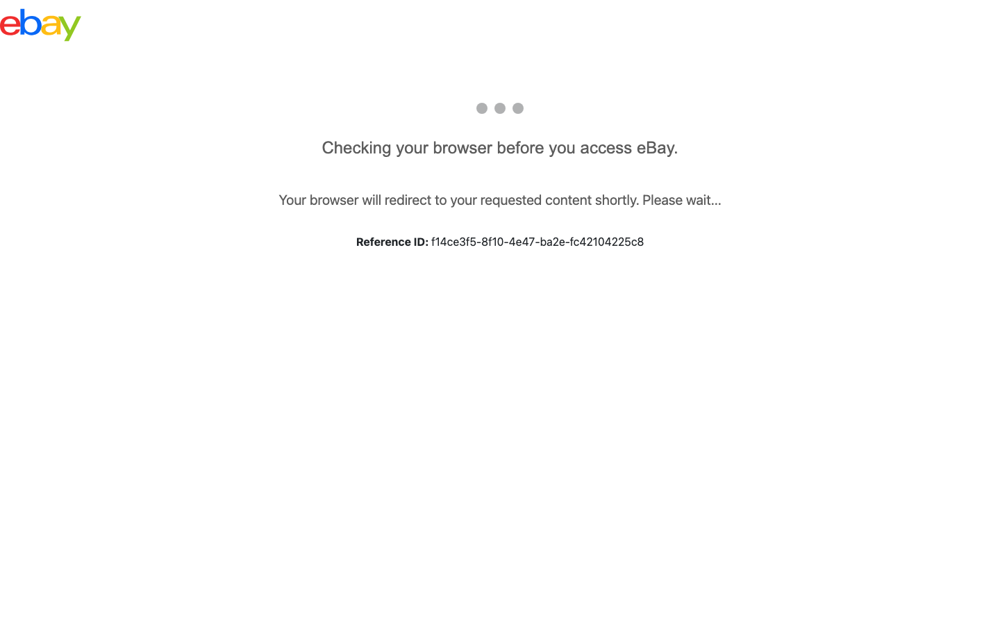

# Reports

```bash
make allure-generate # builds reports/allure-report/index.html
make open             # opens it
```

The report is generated as a **single self-contained HTML file**, so it opens straight from disk - no `allure serve`, no web server.

Every run produces:
- **Allure report** with a step per function, a screenshot per item added, the cart screenshot and the collected URLs
- **Browser console log** attached to failed tests: console messages, uncaught page errors and HTTP responses >= 400 (only when there were any). The same lines go to Python logging under the `browser` logger - see them live with `pytest --log-cli-level=DEBUG`.
- **JUnit XML** at `reports/junit.xml` (for CI)
- **Playwright trace** at `reports/traces/*.zip` (on failure, or always with `--profile=ci`). Open with `playwright show-trace <file>`.

Trend history (pass-rate, duration, flaky markers across runs) carries forward automatically between generates - see `make allure-generate` in the [Makefile](../Makefile).

## CI reports

Every CI run (`.github/workflows/ci.yml`) publishes its Allure report to GitHub Pages - one permanent page per run (`reports/<timestamp>_<commit>/index.html`) plus a `reports/latest/index.html` pointer, with trend history carried across runs via the `gh-pages` branch. The run's commit, branch, trigger and timestamp are recorded in the report's Environment panel. Links to both are printed in the workflow's job summary; traces and screenshots are also uploaded as a 14-day workflow artifact. `pull_request` runs skip publishing (no push access needed) and rely on the artifact instead.

## Failure categories & error messages

Every framework error has a tagged, self-explanatory message, for example:

```
[BUDGET EXCEEDED] Cart subtotal 512.40 ILS is above the allowed 220.00 x 2 item(s) = 440.00 ILS (over by 72.40 ILS).
[ELEMENT NOT FOUND] 'Add to cart button' was not found on https://www.ebay.com/itm/... within 5000 ms. Tried selectors: [...]
```

`config/allure/categories.json` (copied into the results automatically) groups failures in the Allure *Categories* tab:

| Category | Status | Meaning |
|---|---|---|
| Cart over budget (product defect) | failed | the business rule under test failed |
| Element not found (page layout changed) | broken | update a locator |
| Blocked by bot protection | broken | HTTP 403/429 or CAPTCHA - environmental; slow down via `slow_mo_ms` (see [BOT_PROTECTION.md](BOT_PROTECTION.md)) |
| eBay error page | broken | error page persisted after refreshes - site-side |
| Login failed | broken | wrong credentials / changed sign-in page |
| Add to cart not confirmed | broken | out of stock, variant issue |
| Price could not be parsed | broken | new price format |
| Network / connectivity | broken | site unreachable (DNS, proxy, VPN) |
| Timeouts | broken | slow page / network |
| No items in price range | skipped | 0 results is a valid outcome |
| Other assertion failures / Unexpected errors | failed / broken | anything else |

Categories are mutually exclusive (verified by `tests/unit/test_categories.py`), so each failure is counted once.

Every page-object action is an `@allure.step`, so the report shows the full flow as a step tree: spec function -> page action -> sub-step, with screenshots attached at the step where they were taken.

## Screenshots

Every screenshot taken during a run (`BasePage.screenshot()`) is attached to its Allure step automatically (`allure.attach.file`), so the full evidence - one image per item added, the cart total, and any failure - lives inside the Allure report itself, not just here.

| Add to cart confirmation | Bot protection detected |
|---|---|
|  |  |

The right-hand screenshot is from a real run against production eBay: the framework detected the CAPTCHA challenge and failed the test with a clear `[BOT CHALLENGE]` message instead of hanging or silently passing - see [BOT_PROTECTION.md](BOT_PROTECTION.md) for why this is not bypassed.
